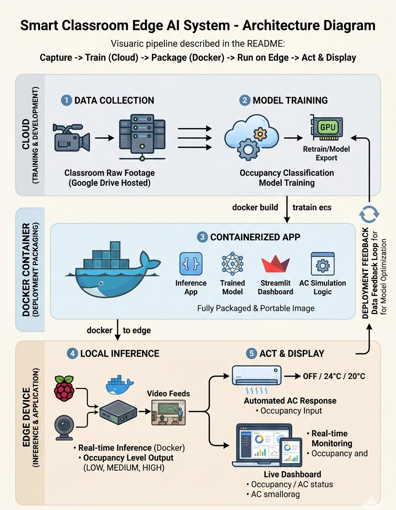

# Smart Classroom Edge AI System

An Edge AI-powered system that detects classroom occupancy from video, performs real-time inference on an edge device, automatically simulates air conditioning control, and provides live monitoring through a web dashboard.

**Course:** Edge Computing | **Instructor:** Thulasee Shan | **University of Jaffna, Class of 2026**

---

## 👥 Team Structure & Roles

*This repository is a fork of the core group project repository. Detailed below are the definitive roles held by each member during development:*

| Role | Members | Responsibilities |
| :--- | :--- | :--- |
| **Product Owner** | **Mohamed Isfak (Me)** | Requirement gathering, system architecture design, roadmap management, documentation, final demonstration. |
| **Project Manager** | Dilshan Rathnaweera | Team coordination, progress tracking, repository management, presentation setup. |
| **App Developers** | Anjana Kavinda, Sanduni Thilakasiri, Perinpanathan Mathushica | Edge application development, Streamlit dashboard UI creation, AC control logic simulation. |
| **Data Scientists** | Manivannan Nirmalan, K.S.I. Kaviraja, R.M.C. Sandharuwan Rathnayaka | Dataset curation, model training/optimization (YOLOv8), ONNX export, and MLOps pipelines. |

---

## 📝 Overview
This project implements an end-to-end Edge AI pipeline for smart classroom management. It detects classroom occupancy from video footage and classifies the environment into **LOW**, **MEDIUM**, and **HIGH** occupancy levels.

The trained model is deployed for local edge inference, allowing the system to operate without depending on cloud connectivity during runtime. Based on the detected occupancy level, the system automatically simulates an appropriate air conditioning response and displays the results through a live Streamlit dashboard.

## 🚀 Key Features
- **Occupancy Detection** — Detects classroom occupancy from real video footage and determines LOW / MEDIUM / HIGH occupancy levels.
- **Edge Inference** — Runs the trained model locally using ONNX Runtime without requiring cloud inference during operation.
- **Automated AC Simulation** — Automatically adjusts the simulated AC state based on detected classroom occupancy.
- **Live Dashboard** — Displays occupancy, detected counts, AC state, temperature, runtime, and occupancy history.
- **Containerized Deployment** — Packages the application, dependencies, and trained model using Docker for reproducible deployment.
- **MLOps-Oriented Deployment** — Supports model export, containerized deployment, and redeployment of updated models to edge environments.

## 📐 Architecture


Classroom video data is collected and used to train the occupancy detection model. The trained model is exported to **ONNX** format for efficient local inference.

The ONNX model is integrated with the edge application and packaged together with the Streamlit dashboard using Docker. During runtime, video is processed locally, occupancy information is extracted, and the detected occupancy level drives the simulated AC control logic.

## 📂 Project Structure
```text
Smart_Classroom_Edge_AI_System/
├── dashboard/         # Streamlit dashboard, inference integration, and dependencies
├── docker/            # Dockerfile and container configuration
├── model/             # ONNX model, labels, metadata, and model test scripts
├── dataset/           # Dataset documentation and external dataset link
├── documentation/     # Project documentation and visual assets
├── .gitignore
├── LICENSE
└── README.md
```

## 📊 Dataset
The complete raw video dataset used for model development exceeds GitHub's practical storage limits and is therefore hosted externally on Google Drive. Dataset information and the external access link are available in the [`dataset/`](./dataset) directory. Raw training footage is not stored directly in Git version control.

## ⚙️ How to Set Up and Run Locally

### Prerequisites
- [Docker Desktop](https://docker.com) installed and running
- Git for cloning the repository
- A modern web browser for accessing the Streamlit dashboard

### Build the Docker Image
Run the following command from the **root directory of the repository**:
```bash
docker build -t smart-classroom-edge-ai -f docker/Dockerfile .
```

### Run the Container
```bash
docker run -d -p 8501:8501 smart-classroom-edge-ai
```
After the container starts, open **http://localhost:8501** in your web browser.

> 💡 **Tip:** For the project dataset and trained model, a detection confidence threshold around `0.15` may provide better detection results. The threshold can be adjusted through the dashboard UI.

### Stop the Container
```bash
docker ps
docker stop <container_id>
```

## 🛠️ Technologies Used
- **AI/ML:** Python, YOLOv8, ONNX Runtime, OpenCV
- **Dashboard & Integration:** Streamlit
- **DevOps & Infrastructure:** Docker, GitHub Actions

## 🔐 Privacy & Ethics
All training footage excludes visible faces and participants under the age of 15, in accordance with dataset collection guidelines. Consent was secured from all individuals appearing in recorded footage.

## 📄 License
This project is licensed under the terms specified in [LICENSE](./LICENSE).
